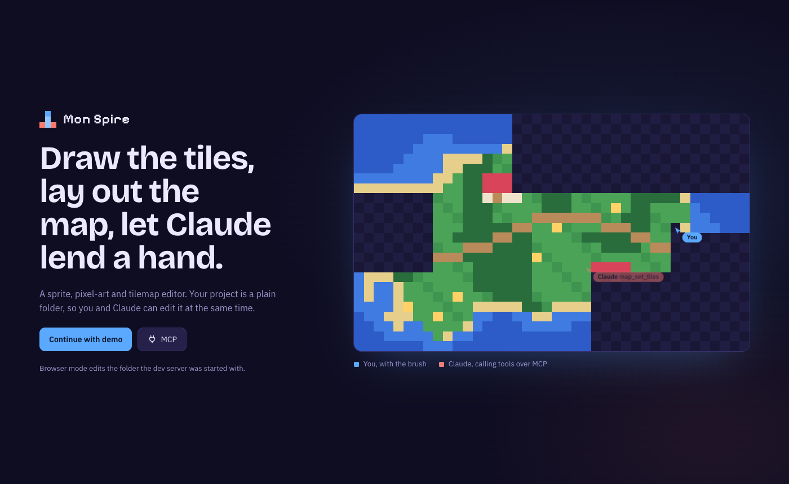
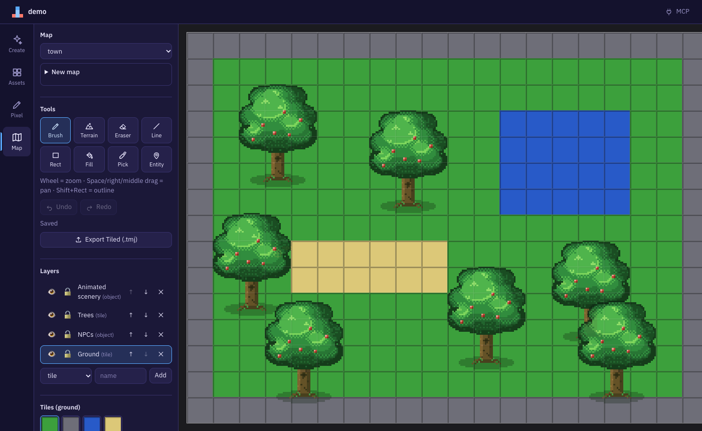
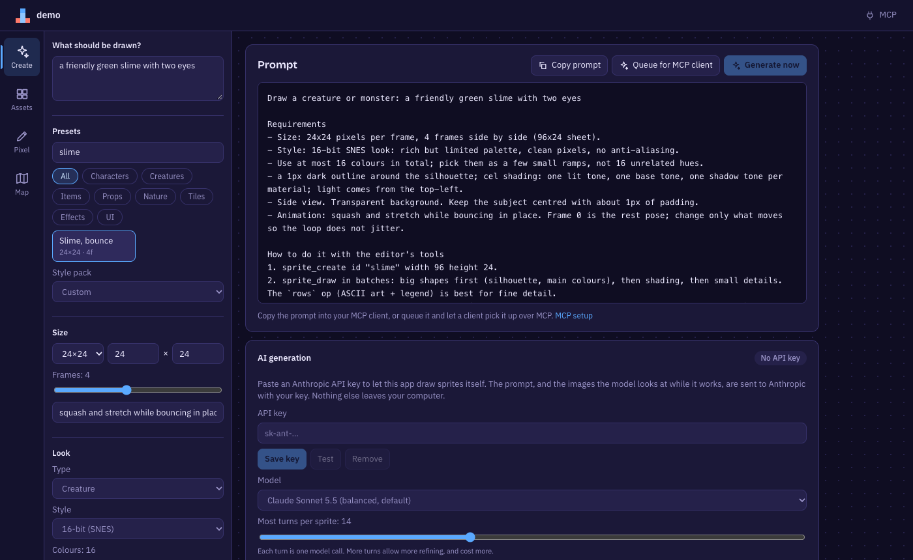
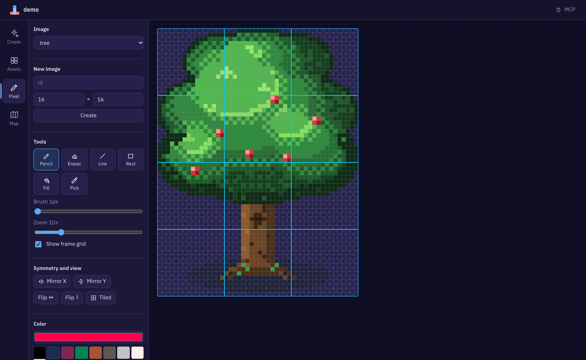

# Mon Spire Editor

A sprite, pixel-art and tilemap editor whose project is a plain folder, so **you and an AI client can edit the same
project at the same time**. It ships as a desktop app (Tauri) and also runs in the browser for development.



- **Draw** pixel art by hand (pencil, line, rect, fill, mirror, flip, tiled preview), slice sheets into frames, build
  tilesets and animations.
- **Lay out maps** with tile, collision and object layers, an autotile terrain brush, block stamps, and entities that can
  play animations.
- **Let an AI help** over [MCP](https://modelcontextprotocol.io): the desktop app has an MCP server built in (30 tools), so
  any MCP client can draw sprites, build maps and read results while you watch the editor update.
- **Generate sprites from a prompt**: a prompt builder with 48 presets and 8 style packs, then either queue the request for
  your MCP client or let the app draw it itself with your Anthropic API key.
- **Export** to Tiled (`.tmj`/`.tsj`) and to an engine-ready sprite atlas (JSON hash, as Phaser and PixiJS read).

| Map editor | Create (prompt builder) |
|---|---|
|  |  |

## Quick start

You need [Node.js](https://nodejs.org) (developed on v24) and [pnpm](https://pnpm.io). The desktop app also needs
[Rust](https://rustup.rs) and, on macOS, the Xcode command line tools.

```bash
pnpm install
```

**In the browser** (fastest way to look around; edits the folder you point it at):

```bash
MSE_PROJECT=$PWD/projects/demo pnpm dev      # http://localhost:5173
```

**As a desktop app:**

```bash
pnpm desktop                  # run in development
pnpm desktop:build            # packaged app: packages/editor/src-tauri/target/release/bundle/
```

On first launch choose a project folder (a folder with `project.json`; an empty folder is offered as a new project).
`projects/demo` is a ready-made example with a town map, apple trees and a swaying tree animation.

## Connect an MCP client

The desktop app listens on `http://127.0.0.1:17877/mcp` while it is open. The **MCP** chip in the top bar opens a panel
with the address, the last request, and Restart, Stop and Start. Nothing to install:

```bash
claude mcp add --transport http spire-editor http://127.0.0.1:17877/mcp
```

Then ask your client for something, for example *"Draw a 32×32 treasure chest in warm browns, preview it, and fix anything
that looks off."* The sprite appears in the editor as it is drawn. The full walkthrough, other clients, the security model
and troubleshooting are in the **[MCP guide](docs/mcp-guide.md)**; every tool is listed in the
**[tool reference](docs/mcp-tools.md)**.

From a checkout, without the desktop app, the same tools run over stdio. The repo's `.mcp.json` already registers them for
Claude Code when you open the repo root; to run the server by hand:

```bash
pnpm mcp projects/demo        # path is relative to the repo root; use an absolute path for your own project
```

## Using the editor

| Tab | What you can do |
|---|---|
| **Create** | Describe a sprite, pick a preset and style pack, copy the prompt, queue it for an MCP client, or generate it in the app. |
| **Assets** | Import PNG sheets, slice into frames, build tilesets (collision, tags, autotile terrain and neighbour mask), build and preview animations, export an atlas, delete sheets. |
| **Pixel** | Draw on a sheet's image or a new image: pencil, eraser, line, rect, fill, picker, brush size, palette, mirror X/Y, flip, 3×3 tiled preview, frame grid overlay. |
| **Map** | Tile, collision and object layers (hide, lock, reorder), brush, terrain, eraser, line, rect, fill, picker, entity; block stamps; zoom and pan; export to Tiled. |



Keys: `B` brush/pencil · `E` eraser · `L` line · `R` rect (hold Shift for an outline) · `G` fill · `I` picker ·
`T` terrain (map) · `N` entity (map) · `Ctrl/⌘+Z` undo · `Shift+Ctrl/⌘+Z` or `Ctrl+Y` redo · mouse wheel zooms the map ·
hold Space or use the right/middle button to pan · Shift-click in the tile palette selects a block to stamp.
In the Pixel tab `+` / `-` zoom, `0` fits the image in the view, `1` shows it at actual size, and ⌘/Ctrl + scroll (or a
trackpad pinch) zooms around the cursor; large sprites can be shown below 100%.

Edits save automatically. If something outside the editor changes a file (an MCP client, git, another tool), the editor
reloads it and the top bar says which file changed.

## Project layout

```
packages/
  core/         data model (zod), project store, undo/redo, drawing, autotile, presets, exporters. No UI, no Node APIs.
  editor/       React + Vite app; src-tauri/ is the desktop shell (Rust)
  mcp-server/   the MCP tools, and a stdio entry point that serves them
projects/demo   example project
docs/           guides and references
e2e/            browser and desktop end-to-end tests (Python + Playwright)
```

A project on disk:

```
project.json         index of every sheet, animation, tileset, map and request
assets/*.png         the art
sheets/ animations/ tilesets/ maps/ requests/    one JSON file per item
export/              generated by the exporters
```

Details and examples are in **[docs/project-format.md](docs/project-format.md)**.

## Documentation

| Document | For |
|---|---|
| [MCP guide](docs/mcp-guide.md) | What MCP is, how this app uses it, connecting clients, worked examples, troubleshooting |
| [MCP tool reference](docs/mcp-tools.md) | Every tool and prompt with its parameters (generated from the server) |
| [Project format](docs/project-format.md) | The files the editor reads and writes |
| [Architecture](docs/architecture.md) | How the pieces fit together, and why |
| [Market notes and roadmap](docs/market-and-roadmap.md) | Similar tools, what this app borrows, what is next |

## Development

```bash
pnpm typecheck            # all packages
pnpm test                 # unit tests: core, mcp-server
pnpm e2e                  # browser end-to-end suites (needs Python 3 with playwright and Pillow, and Google Chrome)
cd packages/editor/src-tauri && cargo test      # Rust: Keychain round trip, port rebind on restart
pnpm docs:tools           # regenerate docs/mcp-tools.md after changing a tool (a test fails if you forget)
```

`pnpm e2e` seeds a throwaway project and starts its own dev server for each suite, so it never touches your projects.
Suites: `boot` (the production bundle must start), `editor_basics`, `mcp_and_assets`, `features`, `create`, `create_ai`
(uses a mock of the Anthropic API). Run one with `python3 e2e/run.py create.py`.

### Commits

Commit messages follow [Conventional Commits](https://www.conventionalcommits.org/): `<type>[(scope)]: <subject>`, for
example `feat(create): add sprite presets` or `fix(ui): make the MCP popup scroll`. Types: `feat`, `fix`, `docs`, `style`,
`refactor`, `perf`, `test`, `build`, `ci`, `chore`, `revert`. Keep the first line to 72 characters.

A `commit-msg` hook in `.githooks/` rejects anything else. Turn it on once per clone:

```bash
git config core.hooksPath .githooks
```

## Known limits

- The editor and an MCP client writing the same file at the same instant are last-writer-wins at whole-file level.
- MCP edits are not on the editor's undo stack (they are separate file writes).
- Autotile uses a 4-neighbour mask (16 tiles per terrain), not the 47-tile blob set.
- Tiled export is one-way; there is no Tiled import.
- The desktop app's Restart/Stop/Start buttons, Keychain access and the in-app generator's network calls are covered by unit
  tests, the browser suites and a Rust test, but not yet by an automated test of the packaged app (see the header of
  `e2e/desktop.py`).
- Deleting a sheet removes its animations and PNG but is refused while a tileset uses it, because maps reference those tiles.
