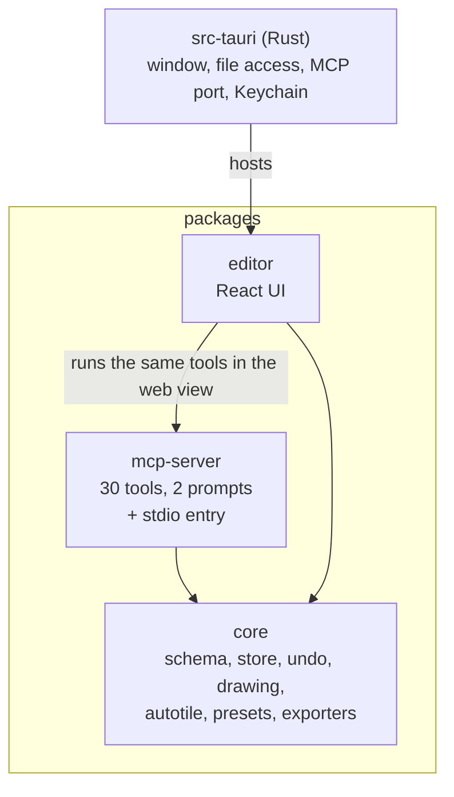
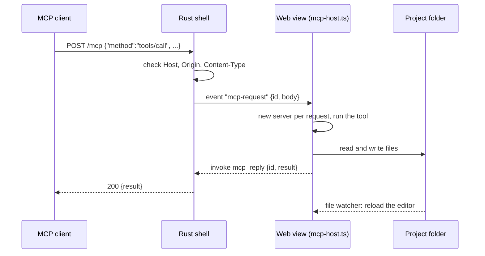

# Architecture

This document explains how the pieces fit together and why they are shaped this way. For file formats see
[project-format.md](project-format.md); for the tools see [mcp-guide.md](mcp-guide.md).

## The idea

A project is a folder of JSON and PNG files. Every part of the system, whether the editor, the MCP server or a script, reads
and writes that folder through one small interface, and anything that changes a file is noticed by the others through a file
watcher. There is no database and no server holding state, so there is nothing to keep in sync: the folder is the state.

`core` depends only on zod and uses no Node or browser APIs, so the same code runs in the editor, in the MCP server and in tests.

## `core`

| Module | Responsibility |
|---|---|
| `schema.ts` | zod schemas for every file; the source of truth for the format |
| `fs.ts` | `FileSystemAdapter` (read/write text and bytes, exists, remove) and an in-memory implementation for tests |
| `store.ts` | `ProjectStore`: load and save each kind of file, keep `project.json` consistent, delete sheets safely |
| `commands.ts` | `History` (undo/redo) and `SetTilesCommand`, which stores only the cells it changed and merges brush segments into one step |
| `draw.ts`, `draw-ops.ts` | Pixel images, shapes, flood fill, and the JSON drawing ops the MCP tools accept (`rect`, `ellipse`, `rows`, `copy`, ...) |
| `slice.ts` | Cut a sheet into a grid of frames |
| `autotile.ts` | Plan tile changes for a terrain brush from 4-neighbour masks; block stamps |
| `export-tiled.ts`, `export-atlas.ts` | Tiled `.tmj`/`.tsj` and a JSON-hash sprite atlas |
| `sprite-prompt.ts`, `presets.ts` | Turn a sprite request into a prompt; the 48 presets and 8 style packs |

Anything that can be a pure function is one, and has unit tests, because that is where bugs are cheapest to catch.

## The editor

State lives in small stores (zustand), and each open document is a `Doc<T>`: the data, a `History`, a 300 ms debounced save, and a
change notification. Views draw from the data and send edits as commands.

A brush stroke, end to end:

1. Pointer events become a `SetTilesCommand` per segment, all with the same merge key.
2. `Doc.exec` applies it, `History` merges it into the previous segment (so one stroke is one undo step), and views repaint.
3. 300 ms after the last change the document is saved through `ProjectStore`, which validates it.
4. The watcher reports the write. The editor compares the file's content with a hash of what it last wrote; if they match it is
   its own echo and is ignored. If they differ, something else changed the file, so the project is reloaded and the top bar says which file.

That last comparison matters. A time window ("ignore writes for 1.5 s") loses an MCP client's edit that lands just after your save.

The editor talks to disk through two interchangeable backends:

| | Browser (development) | Desktop |
|---|---|---|
| Access | `HttpFs` to a small Vite plugin (`server/project-fs.ts`) that serves one folder and refuses paths outside it | `TauriFs` over Tauri's fs plugin, scoped to folders you picked |
| Watching | server-sent events | Tauri's recursive watcher |

## The desktop shell

`src-tauri/src/lib.rs` is deliberately small. It does what a web view cannot:

- **Listen on a port.** A `tiny_http` listener on `127.0.0.1` accepts `POST /mcp`, checks `Host`, `Origin` and `Content-Type`, and emits the
  body to the web view as an `mcp-request` event. The web view replies through the `mcp_reply` command. The shell knows nothing
  about tools. `mcp_status`, `mcp_restart`, `mcp_stop` and `mcp_start` back the status panel; a restart rebinds the same port.
- **Keep a secret.** `secret_set`, `secret_get` and `secret_delete` use the OS credential store, restricted to names beginning with `mse_`.
- **Open a project at launch** (`--project <dir>`), and read two test overrides, `MSE_MCP_PORT` and `MSE_API_BASE_URL`.

Plugins: fs (with watch), dialog, persisted-scope (remembers the folders you chose), http (for the generator, limited to the Anthropic API and localhost).
Permissions are listed in `capabilities/default.json`.

## MCP inside the app

Requests are stateless: each one gets a fresh `McpServer` with the same tool set and a transport that captures the single
response. The tool code is exactly `packages/mcp-server/src/server.ts`. Inside the web view `pngjs` is aliased to its browser build, because
the default entry needs Node's `util` and `zlib`, and Buffer is provided by a polyfill. The tool writes through a plain file
adapter rather than the editor's tracking one, so the watcher sees them as outside edits, which is what updates the screen.

## The in-app generator

*Generate now* runs a short agent loop (`lib/agent.ts`, `lib/generate.ts`):

1. Create a request (`in_progress`) and list the same tools an outside client would see, minus `sprite_import`.
2. Call the Messages API with the brief. For each `tool_use`, run the tool in-process and send the result back, including
   `sprite_preview` images, so the model can see its work. Only the newest images are kept, to save tokens.
3. Stop when the model stops asking for tools, when the turn limit is reached, or on **Stop**. A cut-off reply is not executed; the model is told to send smaller batches.
4. Mark the request `done` only if the sheet exists, otherwise `failed` with the reason.

On desktop the HTTP call goes through Rust (`tauri-plugin-http`); in the browser it is a direct `fetch` with the browser-access header.
The key comes from the Keychain, or memory. The model, turn limit and API address are settings; none of them contain the key.

## Testing

| Level | What | Run |
|---|---|---|
| Unit | `core` (58 tests): schemas, store, undo and merge, drawing ops, autotile, exporters, presets, prompt text | `pnpm test` |
| Unit | `mcp-server` (32): every tool through an in-memory MCP client; the generated reference must match the server | `pnpm test` |
| Rust | Keychain round trip on macOS; stop then rebind the same port | `cargo test` in `src-tauri` |
| End to end | Six browser suites on Chrome with Playwright: production bundle boots, editing, MCP and assets, features, request queue, generator (against a mock of the API) | `pnpm e2e` |
| Desktop | Not yet automated end to end: see the note at the top of `e2e/desktop.py` | |

The end-to-end runner gives every suite a fresh throwaway project and its own dev server. `boot` loads the **production** bundle, because
a crash while modules load (as happened once with `pngjs`) leaves an empty window that no other test notices.

## Decisions and trade-offs

| Decision | Why | Cost |
|---|---|---|
| The folder is the state; sync by file watcher | Nothing to keep consistent; works with git; any tool can take part | Two writers on one file at the same instant is last-writer-wins at whole-file level; MCP edits are not on the editor's undo stack |
| MCP server in the web view, not a sidecar process | No Node to bundle (the app is ~17 MB), the same TypeScript as the stdio server | The server lives and dies with the window |
| Command objects with deltas for undo | Cheap on large maps; strokes merge | Each new kind of edit needs its own command |
| Autotile with a 4-bit mask (16 tiles per terrain) | Easy to author and to explain | No 47-tile blob sets, no diagonal corners |
| Prompt builder first, API key second | Works with any MCP client at no cost; the key is optional | Without a key the app cannot draw by itself |
| Tile numbers are positions in the tileset | Compact maps, simple format | Tiles cannot be removed from the middle without renumbering maps |
