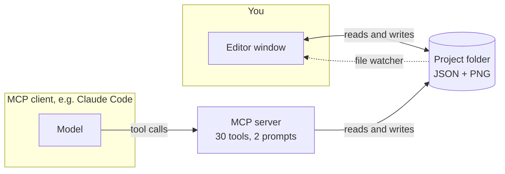

# MCP guide

This guide explains what MCP is, how Mon Spire Editor uses it, how to connect a client, and how to get good results.
Every tool is documented in the [tool reference](mcp-tools.md).

## 1. What MCP is

**MCP** (Model Context Protocol) is an open standard that lets an AI application use tools that live somewhere else.
Think of it as a USB port for AI: the application has one kind of plug, and any program that speaks MCP can be plugged in.

| Term | Meaning here |
|---|---|
| **Client** | The AI application you talk to: Claude Code, Claude Desktop, or any other MCP-capable app. |
| **Server** | A program that offers tools. Here that is Mon Spire Editor (inside the desktop app) or the `mcp-server` package. |
| **Tool** | One action the server can perform, with named parameters: `sprite_draw`, `map_fill`, `export_atlas`. The model decides when to call it. |
| **Prompt** | A ready-made brief the server offers, which the client can show as a command (for example `draw_sprite`). |
| **Transport** | How the two talk. Two are used here: **HTTP** (desktop app) and **stdio** (a process the client starts). |

Without MCP a chat model can only *describe* a sprite. With it, the model can call `sprite_draw`, look at the picture
that `sprite_preview` returns, notice the eyes are crooked, and fix them, all inside your project.

## 2. How this app uses it



The project is a plain folder. The editor and the server both read and write it, and the editor reloads whatever changes on
disk. That one rule is why you can draw while a client draws: nobody has to be told anything, and the top bar shows
*Changed outside the editor: <file>* when a client touches something.

There are two ways to run the same tools:

| | Built into the desktop app | `mcp-server` over stdio |
|---|---|---|
| Transport | HTTP on `127.0.0.1` (port 17877 by default) | stdio (the client starts it) |
| Which project | Whichever one is open in the editor, and it follows you when you switch | The folder you pass on the command line |
| Needs | Only the app | A checkout of this repo and `pnpm install` |
| Image previews | Yes | Yes |
| Use it for | Everyday use | Headless use, scripts, CI, development |

Both come from the same code (`packages/mcp-server/src/server.ts`), so they offer identical tools.

## 3. Connect a client

### Claude Code (desktop app, HTTP)

Open Mon Spire Editor and a project, then:

```bash
claude mcp add --transport http spire-editor http://127.0.0.1:17877/mcp
```

Or put this in a `.mcp.json`:

```json
{ "mcpServers": { "spire-editor": { "type": "http", "url": "http://127.0.0.1:17877/mcp" } } }
```

The **MCP** chip in the app's top bar shows the real address and port. If 17877 was busy when the app started it takes the
next free port (up to 17896), and the chip shows which. Starting the app with `MSE_MCP_PORT=17950` begins the search at that port instead.

### Claude Code (stdio, from a checkout)

The repo's `.mcp.json` already does this when you start Claude Code in the repo root:

```json
{ "mcpServers": { "spire-editor": { "command": "pnpm", "args": ["--silent", "exec", "tsx", "packages/mcp-server/src/index.ts", "projects/demo"] } } }
```

For your own project, change the last argument to its folder (an absolute path is safest).

### Claude Desktop and other stdio-only clients

Some clients can only start local programs. Use a small bridge that turns the HTTP address into stdio, for example
`npx -y mcp-remote http://127.0.0.1:17877/mcp` as the server command in the client's MCP configuration. Or run the stdio server
from a checkout as above.

### Check that it works

Ask the client: *"Call project_info."* You should get the project name and the ids of its sheets, tilesets and maps. If you
get an error instead, see [Troubleshooting](#7-troubleshooting).

## 4. Security

- **Local only.** The server binds to `127.0.0.1`, so other computers cannot reach it.
- **Web pages cannot use it.** Requests must have `Host: 127.0.0.1:<port>` (or `localhost`) and must **not** carry an `Origin`
  header, which browsers always add to cross-site requests. A web page or a DNS-rebinding attack therefore gets `403`.
  Only `POST` with `Content-Type: application/json` does anything (`DELETE` is accepted and ignored, `GET` is refused).
- **There is no password.** Any program running as you on this computer can connect and edit the open project. This is the
  same trust level as having the project folder open. Stop the server from the MCP panel (Stop) when you do not want that.
- **What a tool can touch.** Tools work inside the open project folder. The exception is `sprite_import`, which reads a PNG from
  any path the server process can read. The in-app generator does not offer that tool to the model.
- **API key (generator only).** The key you paste for *Generate now* is stored in the operating system's credential store
  (macOS Keychain, Windows Credential Manager, Secret Service) and never in a file or local storage. Choosing not to remember
  it keeps it in memory until the app closes.

## 5. Worked examples

You rarely write tool calls yourself; you describe the goal and the client chooses the calls. The sequences below show what
happens, which helps you phrase requests and understand results.

### 5.1 Draw a sprite

> *Draw a 32×32 treasure chest in warm browns, preview it, and fix anything that looks off.*

1. `sprite_create` `{ "id": "chest", "width": 32, "height": 32 }` makes a blank, transparent image.
2. `sprite_draw` places big shapes first, then shading, then details. One call takes many ops:

   ```json
   { "sheetId": "chest", "ops": [
     { "op": "rect", "x": 4, "y": 12, "w": 24, "h": 14, "color": "#8a5a2e" },
     { "op": "ellipse", "cx": 16, "cy": 12, "rx": 12, "ry": 5, "color": "#a0693a" },
     { "op": "rows", "x": 14, "y": 14, "rows": ["gg", "gg"], "legend": { "g": "#ffcd75" } }
   ] }
   ```

   `rows` is ASCII art: each character is looked up in `legend`, and characters not in the legend are left alone. It is the
   best way to place fine detail.
3. `sprite_preview` returns the image, enlarged. The model looks at it, and calls `sprite_draw` again to fix what is wrong.
   Good results come from this look-and-fix loop, so ask for it.
4. `sprite_get` returns the pixels as text if the model needs to read exact positions or colours.

Colours are `#rgb`, `#rrggbb`, `#rrggbbaa` or `transparent`. If one colour in a batch is invalid the whole batch is rejected and the image
is untouched.

### 5.2 Use it in a map

A sprite becomes tiles by slicing:

1. `sprite_slice` `{ "sheetId": "tree", "frameWidth": 16, "frameHeight": 16 }` cuts a 48×64 tree into 12 frames (`tree_0` … `tree_11`).
   **Slicing again replaces the frames**, so run `project_validate` afterwards.
2. `tileset_create` `{ "id": "trees", "name": "Trees", "sheetId": "tree" }` turns the frames into tiles 1..12.
3. `layer_add` creates a tile layer that uses that tileset.
4. `map_stamp` places the whole 3×4 block in one call (`0` skips a cell):

   ```json
   { "mapId": "town", "layerId": "trees", "x": 2, "y": 2,
     "rows": [[1,2,3],[4,5,6],[7,8,9],[10,11,12]] }
   ```
5. `map_render_preview` shows the whole map. Ask the model to look at it.

### 5.3 Paint terrain with automatic edges

Mark the tiles of a terrain once, with the neighbours each one expects (N=1, E=2, S=4, W=8, added together; 15 means all four sides are
the same terrain, 0 means alone):

```json
{ "tilesetId": "ground", "terrain": "grass",
  "tiles": [ { "tile": 1, "mask": 0 }, { "tile": 2, "mask": 1 }, { "tile": 3, "mask": 2 } ] }
```

Then `map_autotile` takes only the cells to paint; edges and corners are chosen for you, and neighbours are re-fitted:

```json
{ "mapId": "town", "layerId": "ground", "terrain": "grass",
  "cells": [ { "x": 3, "y": 3 }, { "x": 4, "y": 3 }, { "x": 5, "y": 3 } ] }
```

`"erase": true` removes the terrain from those cells. A full set has 16 tiles; a missing mask falls back to mask 15.

### 5.4 Animate

An animation is frames laid out side by side in one sheet. Derive frames from frame 0 with the `copy` op instead of redrawing:

```json
{ "op": "copy", "x": 0, "y": 0, "w": 56, "h": 64, "dx": 56, "dy": 0,
  "rowShift": [3, 3, 3, 2, 2, 2, 1, 1, 0, 0, 0] }
```

`rowShift` moves each source row sideways (rows past the end of the list are not shifted), so the top of a tree can sway while its trunk stays planted. Then
`sprite_slice`, and `animation_create` with `frameIds` and `fps`. To use it on a map, `entity_place` an object with
`"props": { "animation": "tree_sway" }`; it plays in the editor, anchored at its bottom centre.
[`packages/mcp-server/examples/`](../packages/mcp-server/examples) has a complete, runnable version that draws a tree and animates it.

### 5.5 Queue sprite requests from the editor

The **Create** tab builds a prompt from a form (48 presets, 8 style packs). **Queue for MCP client** saves it as a request in
the project. In your client, run the `do_pending_requests` prompt or say *"Do the pending sprite requests."* The client then:

1. `request_list` to see what is waiting,
2. `request_claim` to take one (it returns the full brief),
3. draws it as in 5.1,
4. `request_complete` with the sheet id, or `request_fail` with a reason you can read.

The request list in the editor follows along: *Waiting for an MCP client*, *Being drawn*, *Done* (with a button to open the
sprite) or *Failed* (with the reason and a *Try again* button).

### 5.6 Export

`export_tiled` writes `export/tiled/<map>.tmj` and the tileset files for Tiled and engines with Tiled loaders; collision layers
become rectangles. `export_atlas` writes `export/atlas/<sheet>.json` (frames in the JSON-hash layout Phaser and PixiJS read, plus an
`animations` block) and a copy of the PNG.

## 6. Getting good results

- **Ask for the loop.** "Preview it and fix anything that looks off" is the most effective sentence. A first draft is rarely the best one.
- **Big shapes first, details last.** Later ops paint over earlier ones.
- **Batch.** One `sprite_draw` with twenty ops is faster and cheaper than twenty calls. The same goes for `map_set_tiles`, `map_fill` and `map_stamp`.
- **Know the coordinate systems.** Map cells are columns and rows (`x`, `y`); entity positions are map **pixels**; tile numbers are
  **1-based** (`0` is empty); sprite coordinates start at the top-left pixel.
- **Name a palette.** For a consistent look give exact hex colours, or choose a style pack (PICO-8, Game Boy, Sweetie-16 and others) in the Create tab.
- **Validate.** `project_validate` finds tiles pointing at missing frames, tilesets without sheets and bad entities. Run it after slicing again or deleting things.
- **Deleting is safe.** `sheet_delete` removes a sheet, the animations built from it and its PNG, and refuses while a tileset uses it.
- **Models differ.** Smaller, faster models are fine for tiles and props; for characters and animation a stronger model with a few refine
  passes is worth the extra turns.

## 7. Troubleshooting

| Symptom | Likely cause and fix |
|---|---|
| The client cannot connect | The app is not running, the server is stopped (open the MCP panel and press Start), or the port differs: read it from the chip. |
| `403` | The request came from a web page (it has an `Origin`) or used another host name than `127.0.0.1`/`localhost`. Use a normal MCP client. |
| `405` on `GET` | Expected. The server does not stream; clients fall back to plain POST. |
| `415` | The request was not `Content-Type: application/json`. |
| `504`, "did not answer in time" | The editor window was closed or is stuck. Reopen it; the server lives in the window. |
| "No project is open" | Open a project folder in the app, then retry. `initialize` and `tools/list` work without one. |
| A tool returns an error | The message says what to change (unknown id, tile outside the tileset, cell outside the map). Fix the call and repeat; nothing was partly applied. |
| The editor does not show a change | Check the top bar for *Changed outside the editor*. A document with unsaved edits is not overwritten; wait a second for auto-save. |
| *Generate now* is disabled | No API key yet. Open **AI generation** in the Create tab and save one. |
| 401 when generating | The API key was rejected. Paste it again and use **Test**. |
| Port already in use after a crash | Start the app again (it takes the next free port), or set `MSE_MCP_PORT`. |

## 8. For developers

**Where the code is.** `packages/mcp-server/src/server.ts` registers every tool. `packages/editor/src/lib/mcp-host.ts` runs the
same server inside the desktop app's web view and answers the requests that the Rust shell (`src-tauri/src/lib.rs`) receives on the
port. The shell only checks the request and forwards it; it knows nothing about tools. See [architecture](architecture.md).

**Add a tool.** Register it next to the others. `safe(...)` turns a thrown error into a tool error the model can read:

```ts
server.registerTool(
  "map_count_tiles",
  {
    description: "Count non-empty cells on a tile layer.",
    inputSchema: { mapId: z.string(), layerId: z.string() },
  },
  safe(async ({ mapId, layerId }) => {
    const layer = (await store.loadMap(mapId)).layers.find((l) => l.id === layerId);
    if (!layer || layer.kind !== "tile") throw new Error(`No tile layer "${layerId}"`);
    return text(String(layer.data.filter(Boolean).length));
  }),
);
```

Keep the description specific (it is what the model reads), validate with zod, make multi-step edits all-or-nothing, and return something
the model can act on. Then:

1. Add a test in `packages/mcp-server/test/server.test.ts` (it talks to the server through an in-memory client, no network).
2. Run `pnpm docs:tools` to regenerate [mcp-tools.md](mcp-tools.md). A test fails if you forget.
3. If the tool needs a file format change, update `packages/core/src/schema.ts` and [project-format.md](project-format.md).

**Try the desktop endpoint without a client:**

```bash
node packages/mcp-server/scripts/http-smoke.mjs http://127.0.0.1:17877/mcp /tmp   # drives a running app with the official client
```

**Run one tool on the stdio server** (from `packages/mcp-server`):
`node scripts/mcp-call.mjs <absolute project path> <tool> '<json arguments>'`.
